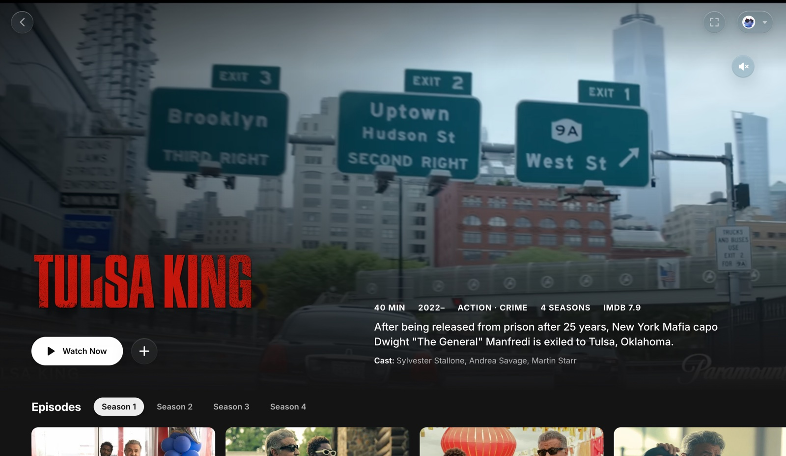
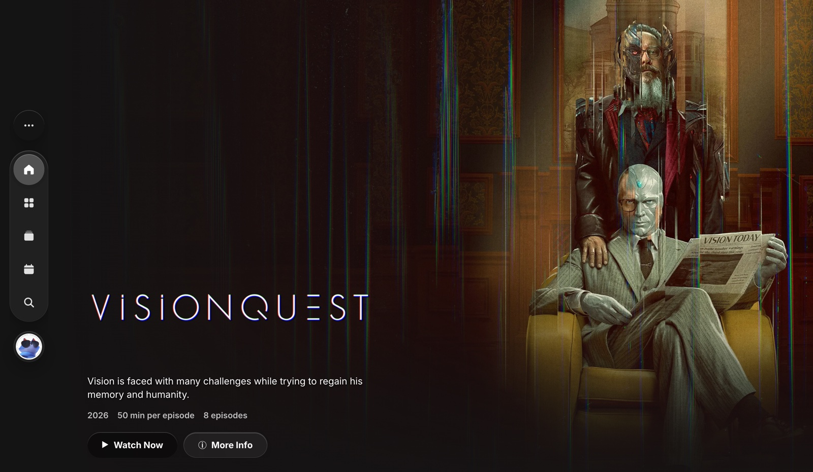
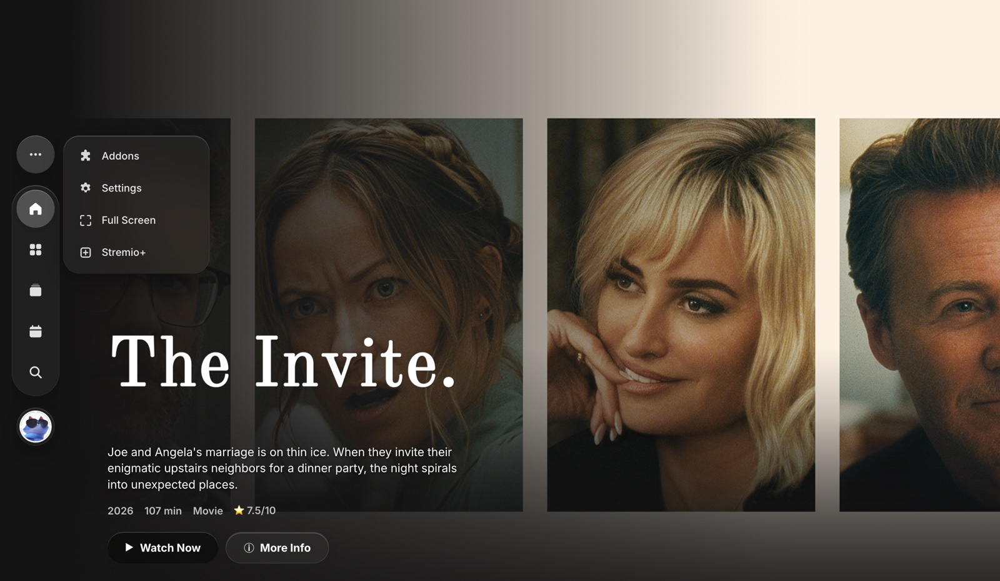
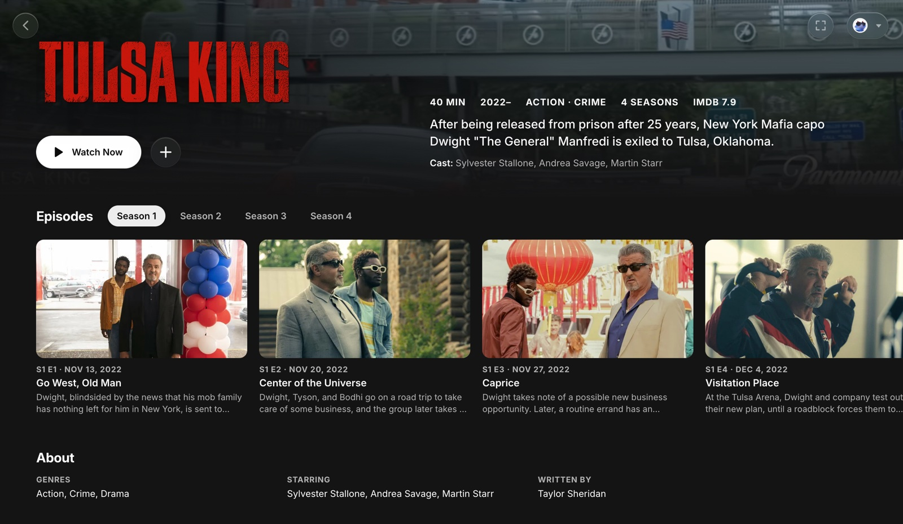
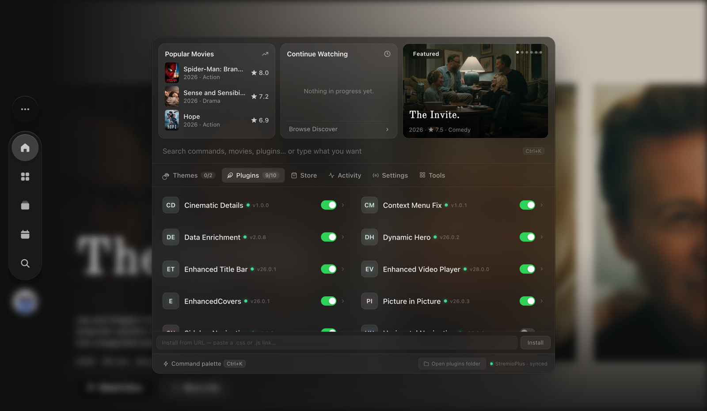
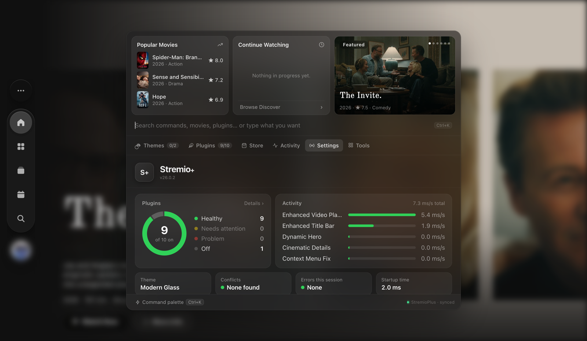
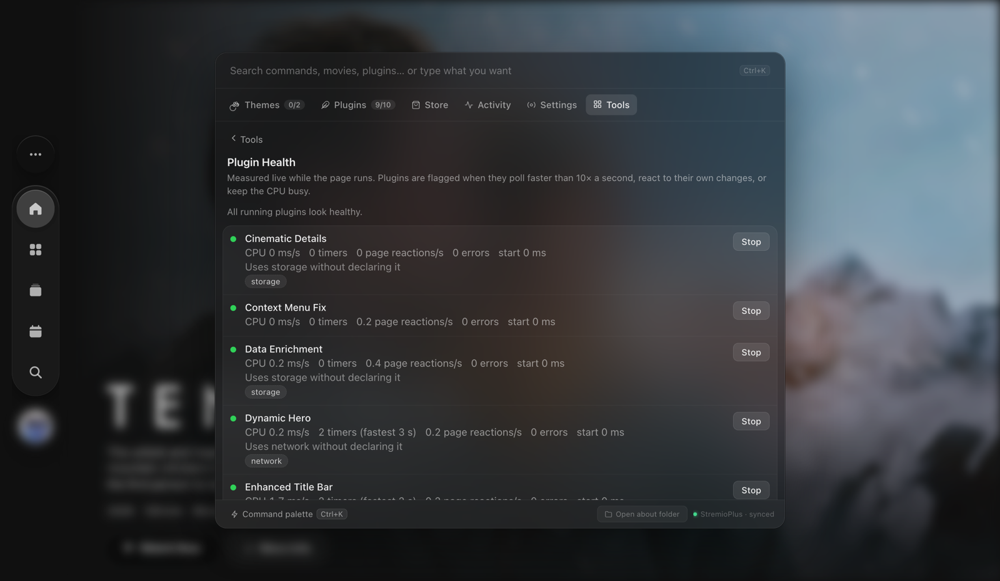
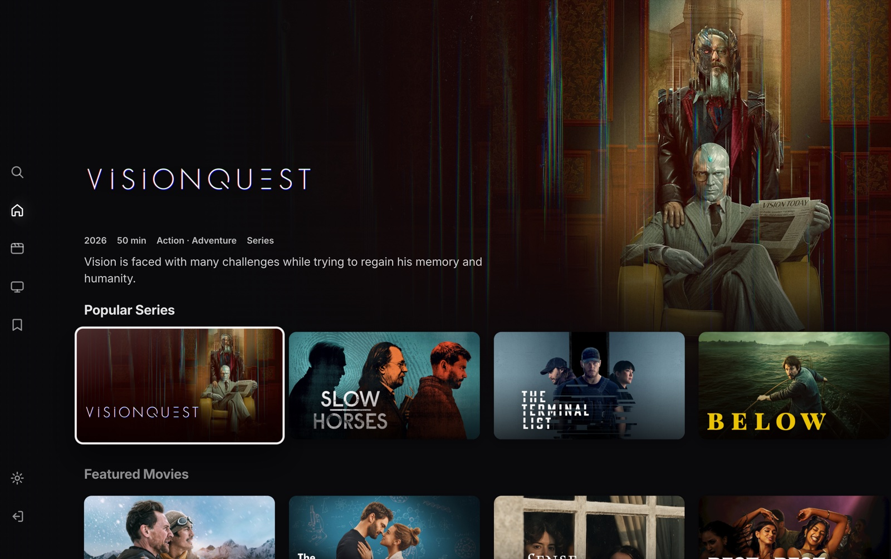
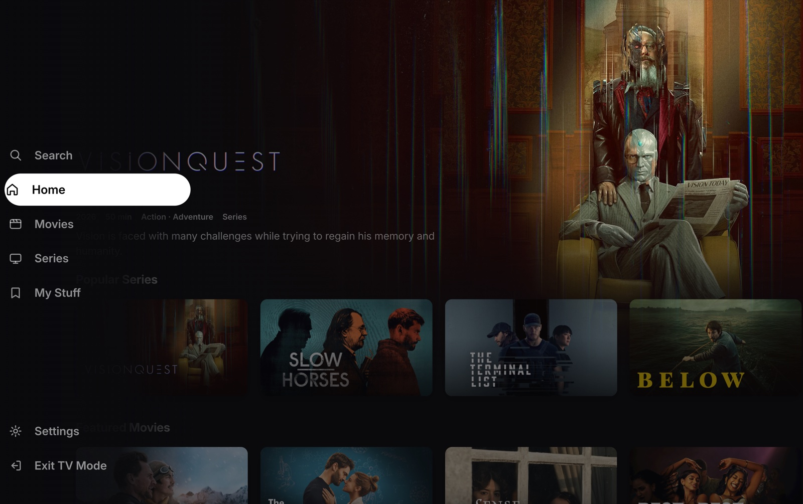
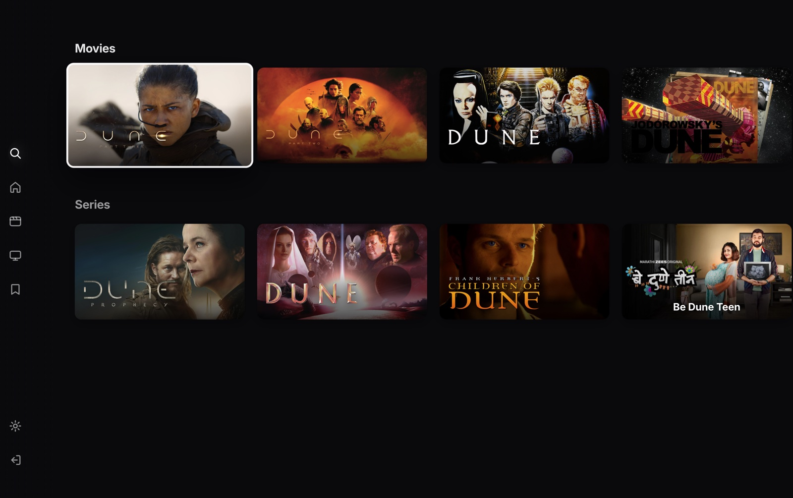

# Stremio Plus for macOS

A native macOS app for [Stremio](https://www.stremio.com) with built-in mpv playback and the
[Stremio Plus](https://github.com/Fxy6969/Stremio-Plus) plugin and theme system.



- **Native playback.** Video plays through mpv, drawn under the web interface, with hardware decoding. No browser codecs, no Electron.
- **Plugins and themes.** Loads Stremio Plus plugins (`.plugin.js`) and themes (`.theme.css`) from the same folder as the Electron app.
- **The Stremio+ menu.** Press **Shift+Space** to manage plugins and themes, search movies and commands, and check how every plugin is behaving.
- **Picture in picture.** The window turns into a small floating player that stays above other apps.
- **TV Mode and remotes.** A full-screen, larger interface you move through with the arrow keys, a game controller or the Siri Remote. Media keys, AirPods and Control Center control the player, and Now Playing shows what's on.

> Proof of concept. Development builds link Homebrew's Qt and mpv and are not yet redistributable (see [Not done yet](#not-done-yet)).

## Screenshots

| | |
|---|---|
|  |  |
| **Sidebar Navigation**: a floating glass tab bar in the style of visionOS | Addons, Settings and Full Screen behind the "…" button |
|  |  |
| **Cinematic Details**: episodes, watched marks and progress under the hero | Search movies, series, plugins and commands from one field |
|  |  |
| Plugins and themes, with widgets for what's popular and what you're watching | A live dashboard: plugin health, CPU use per plugin, conflicts and errors |
|  | |
| Plugin Health: timers, page reactions, errors and undeclared access, measured live | |

## Included plugins and theme

[`mods/`](mods) holds the plugins and theme made for this app. Copy them into
`~/Library/Application Support/stremio-plus/plugins` and `…/themes`, then turn them on in the Stremio+ menu.
They also work in the Electron app.

| | |
|---|---|
| [Cinematic Details](mods/plugins/Cinematic-Details.plugin.js) | Title pages in the style of a streaming service: the trailer plays full screen behind the logo, with Watch Now (resumes the right episode), Add to Library, season tabs and episode cards. Stream lists open as a sheet. |
| [Sidebar Navigation](mods/plugins/Sidebar-Navigation.plugin.js) | Replaces the top navigation with a floating glass tab bar: icon tabs, a "…" button for the rest (including TV Mode), search and your profile. Use it instead of Horizontal Navigation. |
| [Picture in Picture](mods/plugins/Picture-in-Picture.plugin.js) | Adds a picture-in-picture button to the player. Uses the app's floating player here and the browser's in Electron. |
| [Context Menu Fix](mods/plugins/Context-Menu-Fix.plugin.js) | Lifts menus (profile, seasons, context menus) above the page so their glass blur works. |
| [Modern Glass](mods/themes/Modern-Glass.theme.css) | The glass theme the screenshots use, with matching styles for the plugins above. |

## TV Mode and remotes



TV Mode is Stremio laid out like the streaming apps on Apple TV. A billboard shows the highlighted title's artwork,
title art, rating and description, with rows of landscape cards underneath. A side menu opens with labels when you
move into it, holding **Search**, **Home**, **Movies**, **Series**, **My Stuff**, **Settings** and **Exit TV Mode**.
Opening a title goes to its page (with Cinematic Details, the trailer page), and Back returns to the same card.

| | |
|---|---|
|  |  |
| The side menu opens with labels | Search with an on-screen keyboard for remotes, or just type |

- **Home** has Continue Watching and the rows from your Board (your add-ons' catalogs).
- **Movies** and **Series** have Popular, Top Rated and genre rows.
- **My Stuff** has Continue Watching and your Library.

Turn it on from the sidebar's **…** menu, the Stremio+ search (**TV Mode**) or **⌘⇧T**. The window goes full screen
and everything is scaled for viewing from across the room.

| | Browse | In the player |
|---|---|---|
| Arrow keys, D-pad, swipe on the Siri Remote | Move the highlight | ← → skip 10 seconds, ↑ ↓ volume |
| Return, A button, click | Open | Play or pause |
| Escape, B button, Menu / Back | Go back; from the rows, open the side menu | Leave the player |
| Play/Pause, media keys, AirPods, Control Center | | Play, pause, skip, scrub |

- **Controllers.** Game controllers and the Siri Remote work through Apple's GameController framework, whenever macOS makes them available to apps. Connecting one outside TV Mode offers to turn it on.
- **Media controls.** Play/pause, skip and scrubbing from media keys, AirPods and Control Center work in any mode, and Control Center's Now Playing shows the title, episode and artwork.
- **For plugins.** `window.stremioPlusShell.tvMode` has `enter()`, `exit()`, `toggle()`, `isActive()` and `remote(name, value)`, which sends a remote command (`up`, `select`, `back`, `playPause`, …) for testing without a remote.

## Install

There is no signed release yet. Build it yourself:

```bash
brew install qtwebengine qtwebchannel qtdeclarative mpv node ffmpeg
```

```bash
./mac/dev-build.sh
```

This builds `build/StremioPlus.app` and installs it as **Stremio Plus** in `/Applications` (quitting a running copy first).

## Writing plugins

Plugins are JavaScript files with a metadata header:

```js
/**
 * @name My Plugin
 * @description What it does, in one sentence.
 * @version 1.0.0
 * @author You
 * @permission storage
 * @permission network
 */
```

- **Permissions.** `storage` (localStorage) and `network` (fetch, XHR, WebSockets) are asked for on first run. Use that isn't declared still works, but Plugin Health points it out.
- **Isolation.** Each plugin's timers, observers, listeners and requests are tracked, so it can be stopped, reloaded or rolled back live without a page reload.
- **Settings and dialogs.** `window.StremioEnhancedAPI` provides `registerSettings`, `getSetting`, `getSettings`, `saveSetting`, `onSettingsSaved`, `showAlert`, `showPrompt`, `applyTheme` and `info`/`warn`/`error` logging, as in the Electron app.
- **Picture in picture.** `window.stremioPlusShell.pictureInPicture` has `enter()`, `exit()`, `toggle()` and `isActive()`. Video plays natively rather than in a `<video>` element, so the browser's picture-in-picture API can't be used.
- **Developer mode.** Turn on Dev mode in Tools → Developer to load plugins from `dev/` in the data folder; they reload when the file is saved.

## How it works

| Piece | What it does |
|---|---|
| `src/main.qml` | Window, mpv under a transparent `WebEngineView`, streaming server process, picture in picture |
| `src/remotecontrol.mm` | Game controllers and the Siri Remote (GameController), media keys and Now Playing (MediaPlayer) |
| `src/mpv.cpp` | Draws mpv into the window underneath Qt Quick's scene (before the web page is drawn on top) |
| `src/shell-bridge.js` | The WebView2-style `window.chrome.webview` API Stremio Web v5 looks for, so it uses its desktop-shell mode and plays through mpv |
| `src/modbridge.cpp` | File access for mods, limited to the data folder, plus HTTPS downloads and folder watching |
| `src/stremio-plus/host.js` | Replaces the Electron preload: plugin API, loading plugins and the active theme, safe updates, dev mode, player transparency, picture-in-picture overlay |
| `src/stremio-plus/runtime.js` | Per-plugin scope (timers, observers, listeners, network, storage, console), health measurements, toasts and the permission prompt |
| `src/stremio-plus/panel.js` | The Stremio+ menu, copied unchanged from Stremio Plus; host.js adjusts it as it loads |
| `src/stremio-plus/commands.js` | Search field: commands, movies and series, natural-language suggestions, clipboard links, Quick Look, keyboard shortcuts |
| `src/stremio-plus/tools.js` | Tools tab: profiles, plugin health, conflicts, shortcuts, widgets, appearance schedule, developer console, theme editor |
| `src/stremio-plus/tv.js` | TV Mode: focus navigation, remote commands, player control, Now Playing |
| `src/stremio-plus/tv-home.js` | TV Mode's screens: billboard, rows, side menu, Movies, Series, My Stuff, Search |
| `src/stremio-plus/settings.js` | Reorganises the menu's Settings tab and adds the status dashboard |
| `src/stremio-plus/widgets.js`, `color-picker.js`, `skin.css` | Widget row, colour picker, macOS look for the menu |

The data folder is `~/Library/Application Support/stremio-plus`, shared with the Electron app. Besides `plugins/` and `themes/` it holds
`profiles.json`, `permissions.json`, `updates.json` with `backup/` (safe updates) and `dev/` (dev mode).

### Options

- `--data-dir=<path>`: use another data folder.
- `--profile=<name>`: a separate browser profile (login, local storage), for example for testing.
- `QTWEBENGINE_REMOTE_DEBUGGING=9223`: inspect the page from Chrome at `http://127.0.0.1:9223`.

## Not done yet

- Release bundling: `macdeployqt`, bundling mpv, node and ffmpeg instead of linking Homebrew, signing and a DMG (`bundle.sh` is still the Qt 5 script)
- Discord Rich Presence, Stremio Plus's external-player routing and its auto-updater
- Plugin alerts and prompts use the browser's built-in dialogs instead of the Electron app's custom ones
- Windows build files were not updated for Qt 6

## Credits

Built on [stremio-shell](https://github.com/Stremio/stremio-shell) and [improved-stremio-shell](https://github.com/edde746/improved-stremio-shell), ported to Qt 6.
The plugin system and the Stremio+ menu come from [Stremio Plus](https://github.com/Fxy6969/Stremio-Plus).

## License

[GPL-3.0](LICENSE.md), inherited from stremio-shell. The Stremio+ menu (`src/stremio-plus/panel.js`) and the plugin system
come from Stremio Plus, which is MIT-licensed.
